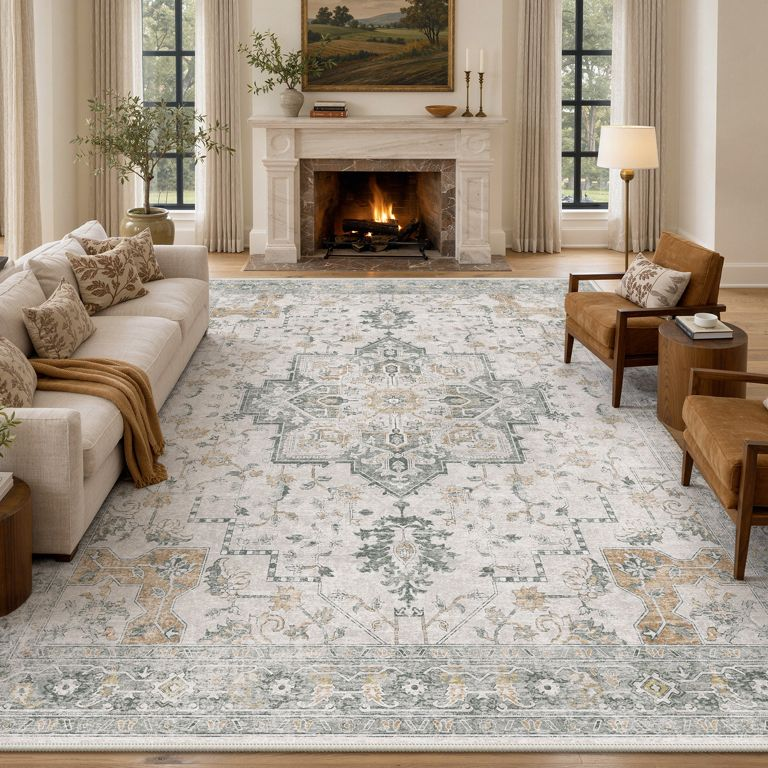
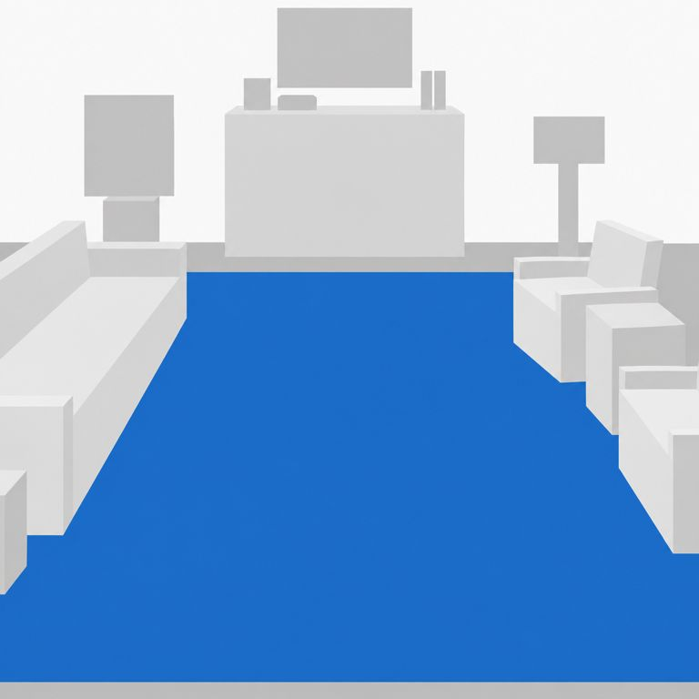
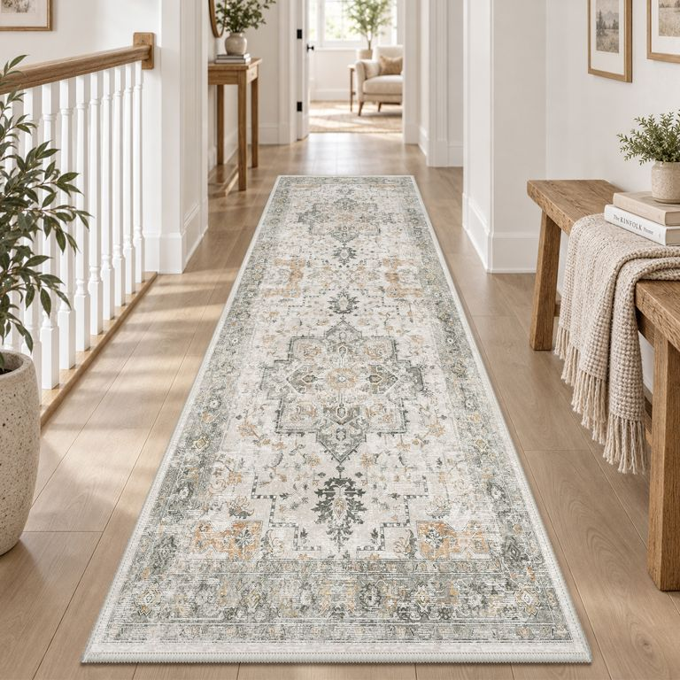
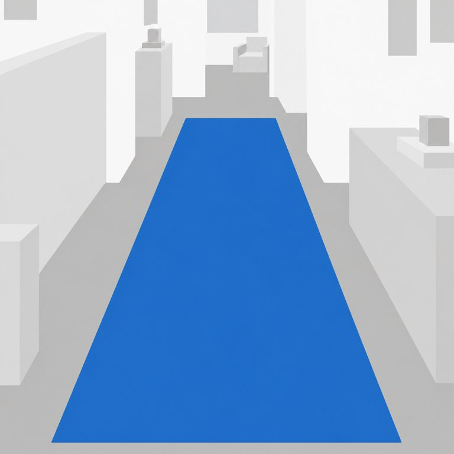
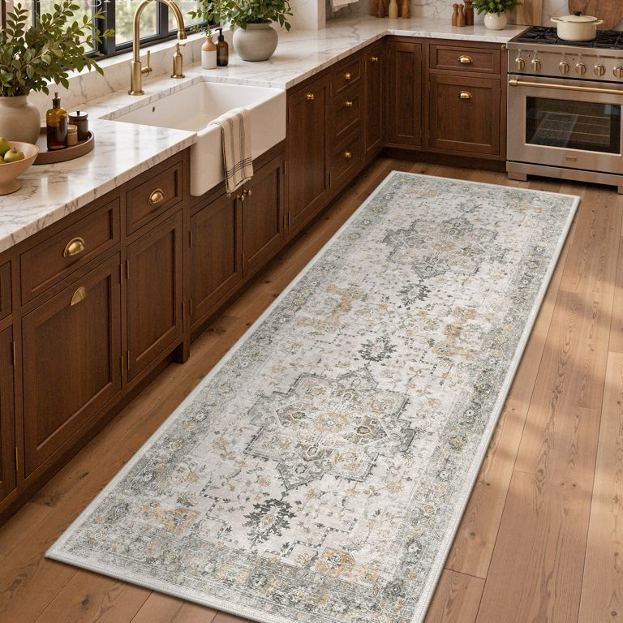
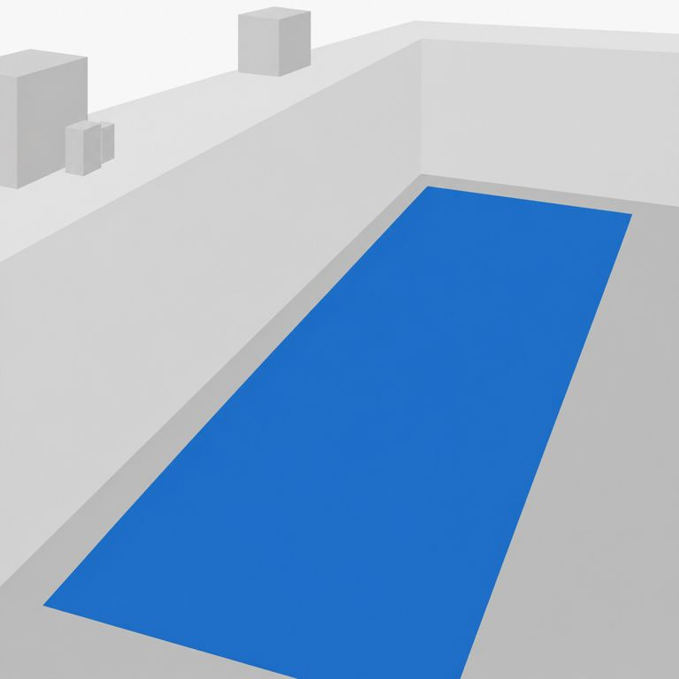

# 室内空间白模转换

将室内照片转换为「饱和蓝色地毯 + 中性白灰方体」空间占位图，用于后续 AI 室内场景生成。

## 技能文件

[interior-color-blockout/SKILL.md](interior-color-blockout/SKILL.md)

## 核心规则

- 原始照片是几何基准，保留机位、取景、家具比例、坐面朝向、遮挡和空间纵深，不人为缩放物体制造纵深。
- 主体家具采用最少必要方体；座椅保留低座体、薄靠背和必要扶手，去除款式细节。
- 连续橱柜合并为整体；壁炉合并为一个完整实心长方体，不保留炉口、框架或台阶。
- 盆栽、灯具和少量摆件使用通用方体占位；门窗与窗帘融入墙面。
- 地毯为单色饱和中蓝，参考 `#2474CC`；其余区域使用中性白灰，清晰区分墙面、地面和家具。
- 不保留纹理、光影、环境遮蔽、反射、渐变、描边或文字。

## 使用方式

将本仓库中的 `interior-color-blockout` 文件夹复制到个人技能目录，例如：

```text
~/.codex/skills/interior-color-blockout/SKILL.md
```

在支持图像编辑的环境中附上室内照片，并调用：

```text
$interior-color-blockout
请将这张照片转换为白模图，保留原图比例、透视和空间占位，并完成叠图及颜色检查。
```

如果还需要去除人物和宠物，请在请求中明确说明；被遮挡区域只能依据照片中的可见证据推断补全。

本技能采用内置图像编辑工具，要求运行环境具备相应能力；技能文件本身不是独立图像生成程序。

## 检查与交付

- 生成前记录地毯角点、主体边界、坐面及墙地交界等锚点。
- 以原图和生成图的 50% 透明叠图检查位置、比例、透视和遮挡；不通过配准或局部变形掩盖误差。
- 独立检查蓝色饱和度、中性灰色偏、墙地灰阶差、相邻体块区分及渐变。
- 交付白模图、叠图、实际提示词及检查结论。生成模型不能保证像素级一致，应如实说明偏差。

## 转换案例

以下为此前实际生成的案例，图片为 768 像素预览。点击图片可查看对应文件；每例均保留实际生成提示词和未经配准的 50% 透明叠图。示例展示实际能力与偏差，并非像素级复刻或完全无光影的理想结果。

| 案例 | 原图 | 白模图 | 检查与提示词 |
|---|---|---|---|
| 客厅 |  |  | [叠图](examples/living-room/overlay.jpg) · [提示词](examples/living-room/prompt.txt) |
| 走廊 |  |  | [叠图](examples/hallway/overlay.jpg) · [提示词](examples/hallway/prompt.txt) |
| 厨房 |  |  | [叠图](examples/kitchen/overlay.jpg) · [提示词](examples/kitchen/prompt.txt) |

- **客厅**：壁炉整体实心化、两侧座椅抽象占位。地毯远边、座椅及装饰体块仍存在局部偏移；植物和落地灯仍有分段，未完全达到每件装饰一个方体的要求。
- **走廊**：保留长地毯收敛与远端座椅的尺度关系；栏杆被概括为整块矮墙，局部家具和植物轮廓与原图有差异。
- **厨房**：橱柜、水槽与灶具合并为连续 L 形整体，地毯斜向投影基本接近；少量饰物已归并或省略。
- 三例的蓝色地毯内部代表点饱和度约 84%–87%，仍可观察到轻微渐变或面间明暗。叠图用于目视核对占位，不代表所有家具均精确重合。
